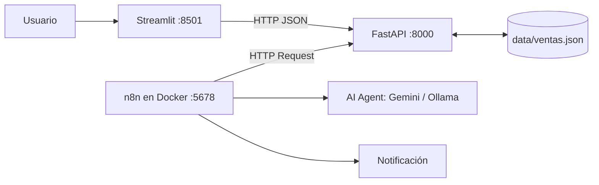

# Arquitectura

## Recorrido de datos
1. El usuario carga una venta o un CSV en Streamlit.
2. Streamlit envía JSON a FastAPI, que valida con Pydantic y guarda en `ventas.json`.
3. n8n consulta `/anomalias` e `/indicadores` por HTTP.
4. El agente de IA recibe los indicadores calculados y redacta un informe.

## Separación reglas vs. IA
- **Python (determinista):** validación, totales, indicadores, anomalías.
- **IA (generativa):** solo redacta el diagnóstico y las recomendaciones a partir de los números.
- **Humano:** revisa el informe antes de actuar.

## Workflows n8n (a implementar)
| # | Nombre | Disparador | Llamadas a la API | Decisión (IF) |
|---|---|---|---|---|
| 1 | Ingesta | Webhook / formulario | POST `/ventas/importar` | ¿hay filas rechazadas? |
| 2 | Anomalías | Schedule | GET `/anomalias` | ¿`cantidad` > 0? |
| 3 | Informe IA | Schedule / Webhook | GET `/indicadores` → AI Agent | ¿ingresos bajo umbral? |
